# unity-skill-plugins

Marketplace `dh-skills`. Shared Claude Code and Codex skills for Unity projects, written once and
picked up by every project on every machine that installs them. The skills hold the policy - how to
write, verify, document and release Unity work. They drive the Editor through an Editor MCP bridge
when one is connected; without one they still apply the conventions and say plainly what could not
be compiled or played.

## Plugins and skills

Every skill is invoked by its bare name (`/coding`). If another plugin uses the same name, the full
form `/unity-core:coding` always works.

### `unity-core` - every role on a Unity project

| Skill | Use before |
|---|---|
| [`/coding`](plugins/unity-core/skills/coding/SKILL.md) | writing, fixing or reviewing any C# |
| [`/recompile`](plugins/unity-core/skills/recompile/SKILL.md) | any recompile or play-mode round trip |
| [`/verify`](plugins/unity-core/skills/verify/SKILL.md) | a play test the user asked for, reproducing a bug in play mode |
| [`/docs`](plugins/unity-core/skills/docs/SKILL.md) | tracked README, CHANGELOG, package.json, feature specs |
| [`/release`](plugins/unity-core/skills/release/SKILL.md) | commit, version bump, tag, release |
| [`/tracking`](plugins/unity-core/skills/tracking/SKILL.md) | adding or changing an analytics event |
| [`/handoff`](plugins/unity-core/skills/handoff/SKILL.md) | writing a plan and prompt for another agent to execute |
| [`/review-loop`](plugins/unity-core/skills/review-loop/SKILL.md) | an implement -> gate -> review loop where the worker never grades itself, at a strictness level you pick for the time you have; a visual track for matching a reference image (triage, frozen shots, measured gates, blind pair judge, pivot rule) |
| [`/solo`](plugins/unity-core/skills/solo/SKILL.md) | working alone in the Editor, every change shown live in the Scene view for the user to steer |
| [`/sheet-data`](plugins/unity-core/skills/sheet-data/SKILL.md) | editing or formatting a Google data sheet with `n_`/`s_`/`f_` headers |

### `unity-ui` - uGUI work

| Skill | Use before |
|---|---|
| [`/ui-panel`](plugins/unity-ui/skills/ui-panel/SKILL.md) | any panel, popup, widget, button or HUD element |
| [`/ui-from-image`](plugins/unity-ui/skills/ui-from-image/SKILL.md) | building a panel prefab from a mockup image |
| [`/brainstorm`](plugins/unity-ui/skills/brainstorm/SKILL.md) | choosing how a UI effect or animation looks |

### `unity-vfx` - real-time effects

| Skill | Use before |
|---|---|
| [`/vfx-core`](plugins/unity-vfx/skills/vfx-core/SKILL.md) | any particle or effect work; the domain skills build on it |
| [`/vfx-combat`](plugins/unity-vfx/skills/vfx-combat/SKILL.md) | skills, hits, projectiles, AoE telegraphs, buffs |
| [`/vfx-ui`](plugins/unity-vfx/skills/vfx-ui/SKILL.md) | particles and shader effects inside a Canvas |
| [`/vfx-environment`](plugins/unity-vfx/skills/vfx-environment/SKILL.md) | ambient, weather, water, fire props, fog |
| [`/vfx-clothing`](plugins/unity-vfx/skills/vfx-clothing/SKILL.md) | garment shaders, outfit auras, reveals and swaps |

`vfx-core` ships a URP uber shader (`assets/VFX_Uber.shader`) and Editor scripts run through
`script-execute`: build an effect prefab, audit prefabs, measure real overdraw in full-screen
equivalents (FSE), capture a contact sheet, and generate textures and meshes. `vfx-combat` adds a
top-down check of an effect's reach against its damage shape.

A project that does no UI work only needs `unity-core`; install `unity-vfx` where effects are made.
A project can ship its own skills on top of these; the project skill wins on conflict.

## Skill index hook

`unity-core` ships one `SessionStart` hook. On startup, after `/clear` and after a context
compaction - not on resume - it checks the project for `ProjectSettings/ProjectVersion.txt`. In a
Unity project it adds `plugins/unity-core/hooks/unity-always.md` to the agent context. Elsewhere it
prints nothing.

That file is an index, not a rulebook: four universal rules, then which skill to invoke before which
kind of work and which docs each skill carries. The rules themselves live in the skills, which load
only when used. Keep the index short - it is paid for on every session, and anything over 10,000
characters is cut to a preview.

Wiring:

- `hooks/hooks.json` calls `hooks/run-hook.cmd session-start`.
- `run-hook.cmd` is a polyglot: cmd.exe runs its batch half, which finds Git Bash; a Unix shell runs
  its bash half. One script therefore serves Claude Code and Codex on Windows, macOS and Linux.
- `hooks/session-start` does the detection and prints the index as
  `hookSpecificOutput.additionalContext`.

On Windows the hook needs Git for Windows. Without bash it exits quietly and only the index is lost.

## Install - Claude Desktop

Once per machine. Every step is a click in the Claude Desktop app.

1. Click the `</>` (Code) button at the top of the sidebar, then **Customize**.

   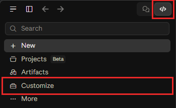

2. Open the **Plugins** tab and click **Discover**.

   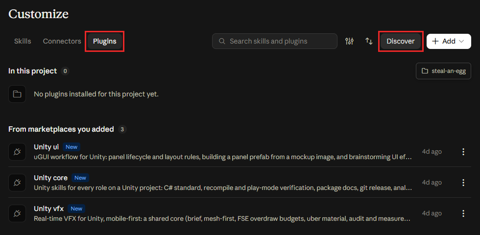

3. In the Directory window, open the **Code** tab and click **+**.

   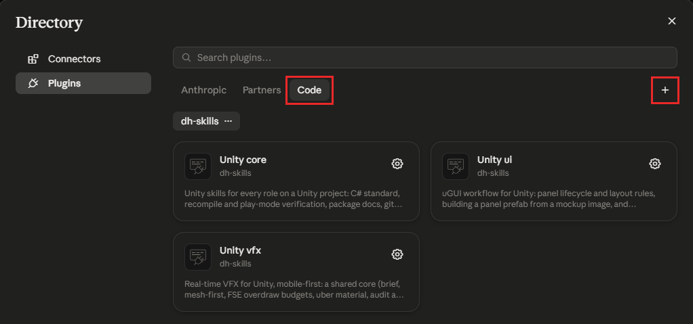

4. Click **Add from a repository**.

   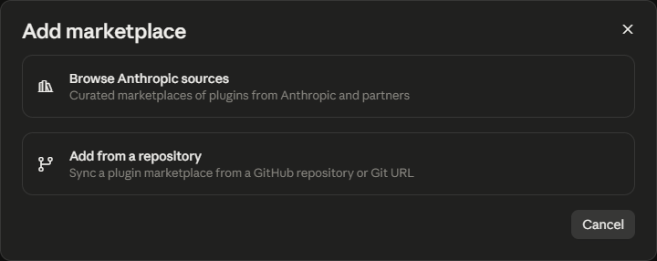

5. Paste `BingoBoiz/unity-skill-plugins` into **URL**, pick the **Use "BingoBoiz/unity-skill-plugins"**
   line under it, then click **Sync**.

   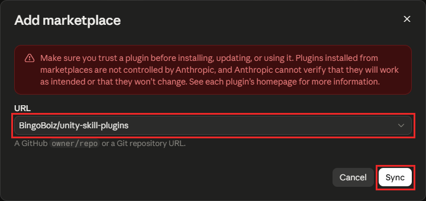

6. A **dh-skills** row appears in the **Code** tab with three cards. Click the **+** on **Unity
   core**, **Unity ui** and **Unity vfx**, and confirm if asked. An installed card shows a gear
   instead of **+**. A project with no UI work only needs **Unity core**.

   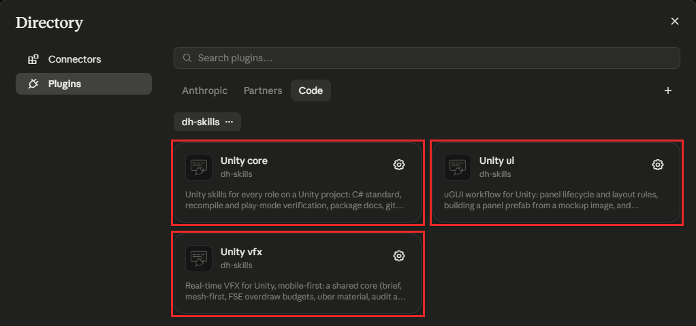

7. Click **New** in the sidebar. Only sessions started after the install see the skills.

   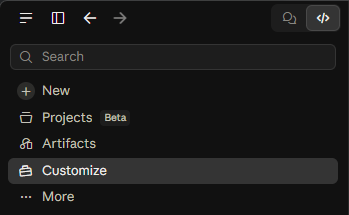

## Install - Codex

Clone this repository, then run the setup script from PowerShell:

```powershell
git clone https://github.com/BingoBoiz/unity-skill-plugins.git
cd unity-skill-plugins
powershell -ExecutionPolicy Bypass -File .\scripts\setup-codex.ps1
```

It installs every plugin; pass `-Plugins unity-core` (or any list) to choose. The manual
equivalent:

```text
codex plugin marketplace add <absolute-path-to-this-repo>
codex plugin add unity-core@dh-skills
codex plugin add unity-ui@dh-skills
codex plugin add unity-vfx@dh-skills
```

Codex requires one safety review for plugin hooks: open Codex, run `/hooks`, review and trust the
`unity-core` `SessionStart` hook, then start a new task from the Unity project root.

## Update - Claude Desktop

Nothing updates on its own. Run this whenever you are told a new version is out.

1. Click the `</>` (Code) button at the top of the sidebar, then **Customize**.

   

2. Open the **Plugins** tab and click **Discover**.

   

3. In the Directory window, open the **Code** tab, click **...** next to **dh-skills**, then
   **Check for updates**.

   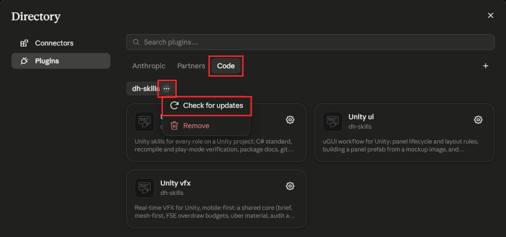

4. Wait for **Marketplace updated.** in the bottom-right corner, then close the Directory window
   with the **X** in its top-right corner.

   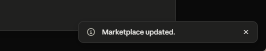

5. Back on the **Plugins** tab, click **Unity core**.

   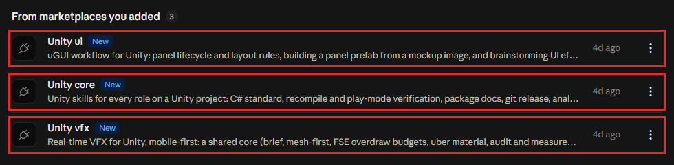

6. Click **Update**. A greyed-out **Update** whose tooltip reads **On latest version** means there is
   nothing new for that plugin. Click **Your plugins** to go back, then repeat steps 5 and 6 for
   **Unity ui** and **Unity vfx**.

   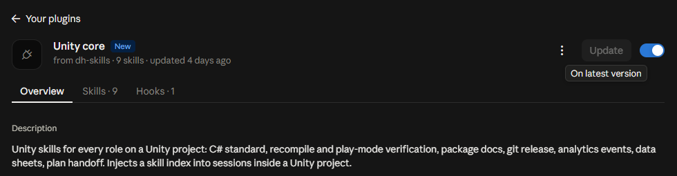

7. Click **New** in the sidebar. A session that was already open keeps the old version.

   

## Update - Codex

```powershell
git pull
powershell -ExecutionPolicy Bypass -File .\scripts\setup-codex.ps1
```

When a hook definition changes, Codex invalidates its trust hash; run `/hooks` and trust the new
definition after reviewing the diff. Start a new task so the refreshed skills are discovered.

## Editing a skill

```bash
git clone https://github.com/BingoBoiz/unity-skill-plugins.git
claude --plugin-dir ./unity-skill-plugins/plugins/unity-core
```

`--plugin-dir` overrides the installed copy for that session, so you can try a change before
publishing it. `/reload-plugins` picks up further edits without a restart. Validate before pushing:

```bash
claude plugin validate .
claude plugin validate ./plugins/unity-core
claude plugin validate ./plugins/unity-ui
claude plugin validate ./plugins/unity-vfx
```

Every plugin declares a `version` (SemVer, the same number in `.claude-plugin/plugin.json` and
`.codex-plugin/plugin.json`), and installed copies are keyed by it. A change to a plugin bumps its
version in the same commit; without the bump, **Update** finds nothing new. Once a bumped change is
pushed, **Check for updates** then **Update** puts every machine on the same rules. Auto-update stays off so
nothing changes mid-task; on a machine that also runs the Claude Code CLI, `~/.claude/settings.json`
carries:

```json
{ "env": { "CLAUDE_CODE_PLUGIN_DISABLE_AUTO_UPDATE": "1" } }
```

Scripts bundled with a skill are addressed through `${CLAUDE_SKILL_DIR}`. A plugin cannot reference
files outside its own directory.

## Layout

```
.claude-plugin/marketplace.json      <- Claude Code catalog; only this file lives here
.agents/plugins/marketplace.json     <- Codex catalog
plugins/<plugin>/
    .claude-plugin/plugin.json       <- Claude Code manifest
    .codex-plugin/plugin.json        <- Codex manifest
    skills/<skill>/SKILL.md          <- skills/ and hooks/ sit at the plugin root
plugins/unity-core/hooks/
    hooks.json  run-hook.cmd  session-start  unity-always.md
scripts/setup-codex.ps1
```

Each entry in `marketplace.json` spells its `source` out as an explicit relative path:

```json
{ "name": "unity-core", "source": "./plugins/unity-core" }
```

Do not use a bare plugin name plus `metadata.pluginRoot`. That shorthand parses fine but Claude Code
2.1.x fails the install with *"This plugin uses a source type your Claude Code version does not
support"*.

## Renaming or removing a plugin

Add an entry to `renames` in `.claude-plugin/marketplace.json` mapping the old name to the new one,
or to `null` if removed. Treat that map as append-only history, or machines still on the old name
break.
